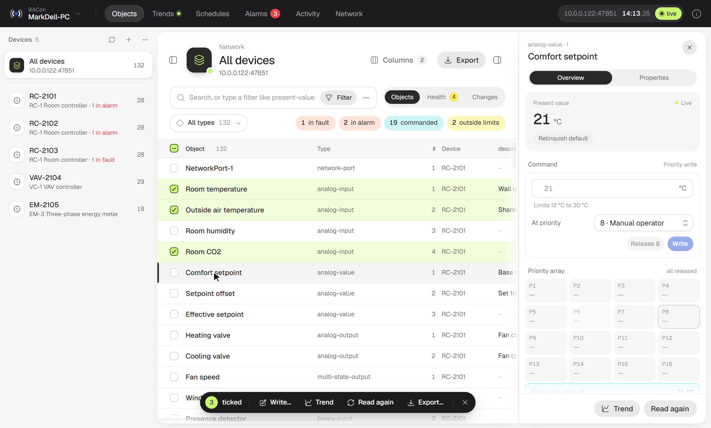
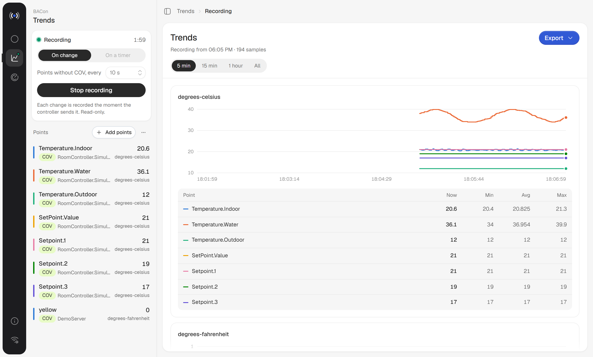
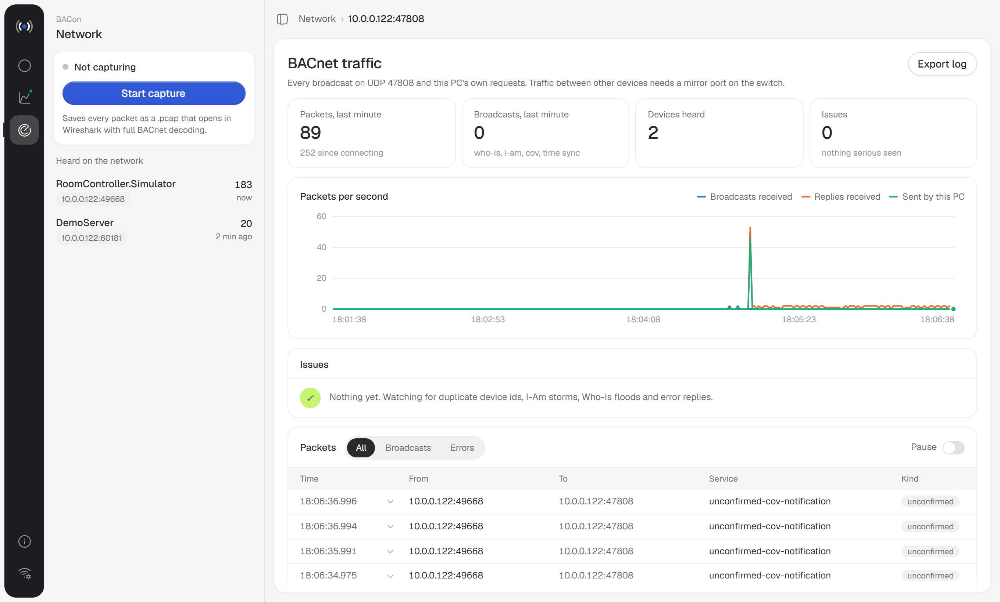
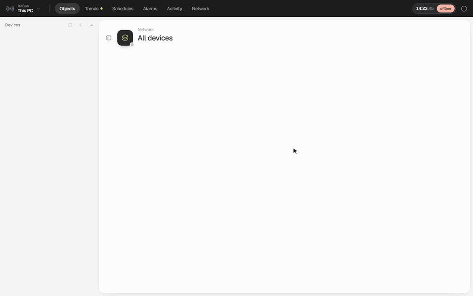
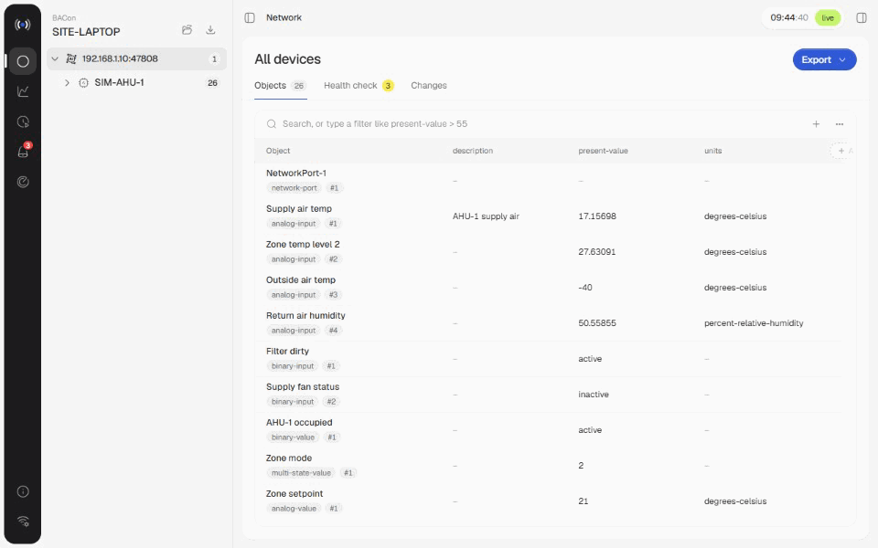
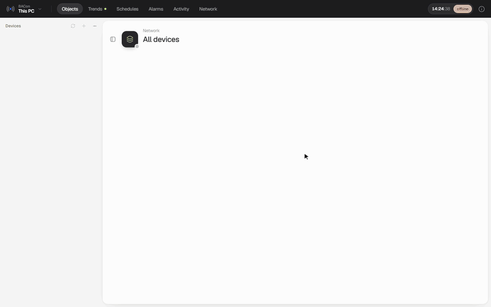
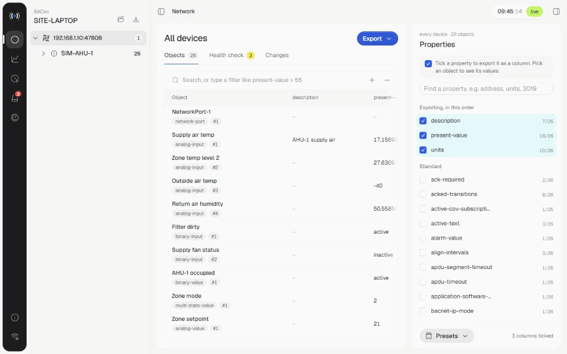
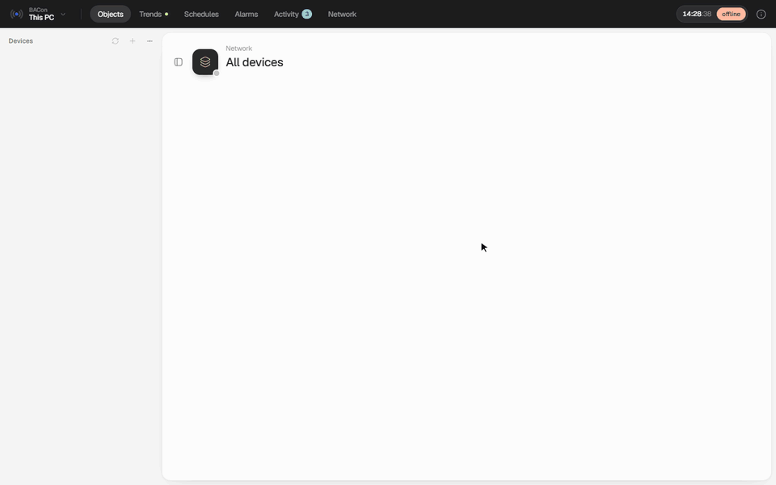

<p align="center">
  
</p>

<h1 align="center">BACon</h1>

<p align="center"><b>BACnet, on site.</b><br>
Scan a BACnet/IP network, read every property of every object, and export what you pick to Excel.</p>

<p align="center">
  <a href="https://github.com/TheeHappyCoder/BACon/releases/latest">Download for Windows</a>
</p>



## Why

Tools like YABE show you every property, but they can't export them. The EDE export leaves out
vendor properties such as the Siemens `Input/Output address [3019]`, which is exactly what you need
for an I/O list. BACon reads everything a controller reports, including proprietary properties, and
lets you choose the columns.

## Features

- **Discover**: Who-Is on any network adapter, optional BBMD registration, or add a device by IP.
- **Read everything**: every object and every property, standard and vendor-specific, with clean
  handling of properties a device doesn't have and objects that fail to read.
- **Pick and export**: tick any property to add it as a column, filter with plain words or queries
  like `present-value > 20`, then export to Excel or CSV.
- **Health check**: saved checks that run against every site you open.
- **Compare**: save a site to a `.bxsite` file and see what changed since.
- **Trends**: record points by COV, falling back to polling, then chart and export them. Trend logs
  bring the controller's own history with them (ReadRange), so you see last night straight away.
- **Schedules**: every Schedule object laid out by week or month as the controller runs it, with
  exceptions, calendars, the value now and the next change.
- **Alarms**: every object with an alarm set up, its state and acknowledgements live from the
  controller (GetEventInformation), what sets it off and who gets notified.
- **Network**: live BACnet traffic, issue detection (duplicate IDs, I-Am storms, error replies) and
  `.pcap` capture for Wireshark.
- **Change anything writable**: command a point at a priority, release it, and change any property the
  controller lets a workstation write (defaults, limits, alarm setup, schedules, calendars), on one point or
  hundreds at once. Every write is reviewed, read back, and kept in BACon's own record.
- **Activity**: what BACon did, kept apart from what the controllers report: before, requested, read back.
  The priority slots BACon still holds are listed to release before leaving site, and any change can be undone.

### Writing

**One point.** Click it. The drawer's Overview shows the live value, a command box (value, priority, Write,
Release), the 16-level priority array with BACon's own slots marked, every other writable setting, the alarm
on the point, and what BACon did to it. Each setting is read live when you edit it, shown as before → after,
then written and read back.

**Many points.** Filter the table (`setpoint`, `Operating mode`, a query), then **Write N shown**. Choose present
value or any property they share. BACon groups points that take the same value the same way, so one choice of
"Standby" writes each controller's own state number. Review, send, and every result is listed.

**Schedules.** In Schedules, **Edit** lays out the week with a preview bar per day, the default, exceptions and
the holiday calendar the exceptions use. Only the properties you change are written.

**Alarms.** Set up intrinsic alarming on a point from its drawer (limits, deadband, delays, which transitions
report, notification class), and acknowledge from Alarms with the controller's own event time stamp.

Every write is checked against what was reviewed, so a value someone else changed in the meantime is refused
rather than overwritten. Commands default to priority 8. A timeout can mean the result is unknown: reload and
look before trying again. Read-back verifies BACnet values, not the equipment. Saved-site devices must be
rediscovered live before writing. The device has the last word: a property it refuses is reported as rejected.
The action log is `%LOCALAPPDATA%\BACon\control\actions.jsonl`.

| Trends | Network |
|---|---|
|  |  |

## What you can do with it

### Find what's wrong with one line

Type a query in the search box and press Enter. It filters every object read, across every device.



| To find | Type |
|---|---|
| Points in fault | `status-flags has fault` |
| Sensors reading too high | `present-value > 26 and units = degrees-celsius` |
| Frost risk | `present-value < 5 and units = degrees-celsius` |
| Anything the controller doesn't trust | `reliability is set and reliability != no-fault-detected` |
| Anything in alarm | `status-flags has in-alarm` |
| Points left overridden or out of service | `status-flags has overridden or out-of-service = true` |
| Inputs with no units | `type = analog-input and units = no-units` |
| Points nobody described | `description is missing` |
| A plant by name | `name contains "AHU-1"` |
| Points with an I/O address (Siemens controllers) | `[3019] is set` |

`and`, `or`, `not` and brackets combine them; quotes go around names or values with spaces, and case
doesn't matter. `!=` also matches objects that don't have the property at all, so pair it with `is set`.

### Keep a query as a health check

Save a query as a check and it runs on every site you open, next to the built-in checks for faults,
alarms, manual overrides, duplicate names and missing descriptions.



### Pick the columns, export to Excel

Tick any property, standard or vendor-specific, and it becomes a column in the table and the export.



### See last night straight away

Add a controller's Trend Log and its stored history is on the chart in seconds, before you've
recorded anything. Each channel of a Trend Log Multiple becomes its own line.



### Read a schedule the way the controller runs it

Every Schedule object, by week or month, with holiday calendars and one-off exceptions laid over the
weekly hours, the value now, and when it changes next.


### See what's in alarm, and why

Objects with an alarm set up, their state and acknowledgements straight from the controller, what sets
them off, and who gets notified.



## Install

Download `BACon.exe` from the [latest release](https://github.com/TheeHappyCoder/BACon/releases/latest)
and run it. There's no installer and nothing else to install. When a new release is out, BACon shows
a dot on the update button in the rail; one click downloads it, checks its SHA-256 and restarts.

Close YABE and other BACnet tools first, or pick another UDP port: many controllers only answer on 47808.

Trend recordings, captures and logs live in `%LOCALAPPDATA%\BACon`. Files older than 30 days are removed.

## Development

Needs Python 3.11+ and Node 20+.

```sh
pip install -e .            # the backend, as an editable install
cd web && npm install

bacon --no-browser          # API on :8047
npm run dev                 # UI on :5173, proxies /api to :8047
```

No site to hand? `python scripts/simdevice.py <your-ip>` runs a simulated controller on UDP 47809 with
points, alarms in every state, schedules, a calendar and trend logs with three days of history. Connect
as usual, then add the device by IP as `<your-ip>:47809`.

For a device with a face, use [Rasher](rasher/README.md): a simulated room controller you can see and
press, with writable points, COV, alarms and faults on demand, that can take its own address on 47808.

`npm run build` writes the UI into `src/bacon/web`, and `bacon` then serves it in its own window.
Use `bacon --browser` to open it in your browser instead.

```
src/bacon/      Python backend: BACnet client, decoding, trends, network monitor, updater
src/bacon/data/ vendor property names
web/            React + Vite UI
packaging/      PyInstaller spec, icon
scripts/        build, release, and the simulated controller
```

## Releasing

```sh
pip install -e ".[build]"
python scripts/build.py                          # dist/BACon.exe + BACon.exe.sha256
python scripts/release.py 0.2.0 "What changed"   # bump, build, tag, push, GitHub release
```

The app updates from the newest GitHub release that has `BACon.exe` and `BACon.exe.sha256` attached.

## Credits

- [bacpypes3](https://github.com/JoelBender/BACpypes3) (MIT) does the BACnet work.
- Vendor property names come from [YABE](https://sourceforge.net/projects/yetanotherbacnetexplorer/)'s
  `VendorPropertyMapping.csv` (MIT, © 2014 Yabe project). See `src/bacon/data/LICENSE-yabe.txt`.

## License

MIT. See [LICENSE](LICENSE).
